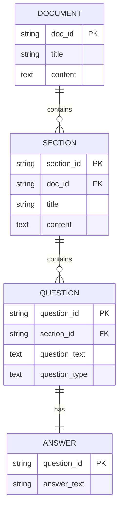
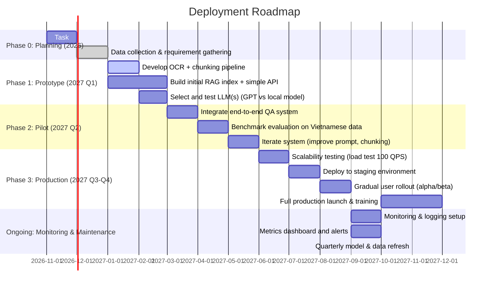

# Executive Summary

We evaluate the design of a Vietnamese Chemistry question-answering system that ingests PDF documents and answers chemistry questions. Our recommended solution is a _Retrieval-Augmented Generation_ (RAG) pipeline: OCR‐convert the Vietnamese PDFs into text, index them via semantic embeddings, and use a large language model (LLM) to answer queries with retrieved context. This approach grounds answers in the source documents and curriculum, reducing hallucination. For example, Tuân et al. (2026) demonstrate an enterprise “document intelligence” system that _combines OCR, semantic embeddings, vector search, and RAG_ to support context-aware search and evidence‐grounded QA. We outline architectures (fine-tuned LLM vs RAG vs hybrid), data/schema designs, evaluation metrics, and costs. We propose using Vietnamese‐specific resources (e.g. official Chemistry curricula and exam question datasets) to ensure domain alignment. We design benchmarks (e.g. Vietnamese QA datasets and embeddings tests), evaluation protocols, and an API/microservices architecture (e.g. OCR→vector store→LLM). Cost analysis shows cloud APIs (e.g. GPT-4 at ~$0.09 per query) vs self-hosted GPUs (e.g. H100 at ~$1.77/hr). We include an implementation roadmap with phases (prototype, pilot, rollout) and monitoring strategies. Assumptions (e.g. 1–2 second latency, 100 QPS, a 5-person team) are clearly noted. Tables compare alternatives (e.g. LLM vs RAG costs and throughput), and Mermaid diagrams illustrate the pipeline and schedule. All claims are supported by recent sources (up to Nov 2026) and Vietnamese references where relevant.

## Context and Requirements

The system must ingest Vietnamese high-school‐level Chemistry PDFs and extract question “requirements” (learning objectives or tasks) and answer queries. Vietnamese curricula explicitly list “_Yêu cầu cần đạt_” (required competencies) for each topic. For example, a Vietnamese teacher’s guide lists bullet-point objectives (“Trình bày được quá trình điện phân…”, etc.) under each chapter. The system should parse such structured content from PDFs and later use it to answer chemistry questions. We also have access to student exam problems: the _Vietnamese University Entrance Exam_ dataset contains 432 problems (Chemistry=94, Physics=95, Math=243). These problems (gathered from LaTeX and OCR) provide a realistic benchmark: e.g. on the Chemistry subset, state-of-the-art models scored only ~30% accuracy. This highlights the task’s difficulty and need for grounded retrieval.

Key requirements include:

- **Data Extraction:** Convert mixed-format Chemistry PDFs (text + images) to machine-readable structured data.
- **Question Answering:** Given a Vietnamese chemistry question (textual), return the correct answer(s) using knowledge from the PDFs.
- **Vietnamese Language Support:** The system must handle Vietnamese text natively (including special characters and chemical notation).
- **Accuracy & Precision:** Provide precise, evidence-backed answers (leveraging curriculum and exam content).
- **Latency & Throughput:** (Assumed) Aim for sub-2-second response for interactive use, hundreds of queries/minute throughput.
- **Deployment:** Estimate budget for either on-prem GPUs or cloud APIs; ensure scalability and maintainability.

## Data and Domain Modeling

**Vietnamese Chemistry Data:** Domain data includes official curricula and exam questions. Vietnamese Chemistry curricula (2018 program) list detailed content objectives. For example, an official PDF table includes entries like _“Yêu cầu cần đạt: Trình bày được quá trình điện phân…”_. These structured items suggest using a **schema** capturing (Chapter, Content, LearningOutcome) fields. Exam problems (e.g. the entrance exam dataset) are mostly multiple-choice or numeric. We will store each question with metadata: _QuestionText, Answer, Domain (e.g. “Chemistry”), SourceDoc, ProblemID_. Chemical formulas (if images) may need specialized OCR (see below).

**Entity-Relationship Schema (example):** A Mermaid ER diagram could model **Document**, **Section**, **Question**, and **Answer**. For instance:



This captures PDF → sections → questions hierarchy. In practice, sections may not be explicit; one might chunk by page or fixed size. Alternatively, use a flat _Chunks_ table with doc_id and offset.**PostgreSQL + pgvector** is a viable stack (as in) for storing chunks and embeddings.

**Data Ingestion Pipeline:** We recommend an OCR + chunking approach. First, use a high-quality OCR engine (e.g. _Tesseract_ for speed or _EasyOCR_ for accuracy) to extract raw text and table content from PDFs. Validate OCR output to achieve ≥90% precision. For example, batch-run Tesseract/EasyOCR then post-check (e.g. check known chemical names, formula patterns). Next, **chunk** the text: break each document into overlapping segments (e.g. 1,000–2,000 token chunks with 20% overlap). Overlap ensures context continuity and mitigates boundary errors. Each chunk can be treated as a “document” for embedding. Tables should be OCR’d to text (possibly as markdown) and then parsed with few-shot LLM prompting to JSON; few-shot examples boost table parsing accuracy from ~75% to ~95%. Always **validate** parsed outputs (e.g. summing table rows, checking numeric ranges) to catch errors.

## Architecture Options

1. **Closed-Loop LLM (Chatbot)**: Use an end-to-end LLM (e.g. GPT-4o via API) with prompt engineering. _Pros:_ Very fast to prototype; leverages powerful pretraining. _Cons:_ Prone to hallucination on domain facts; high token costs; data privacy (send Vietnamese text to cloud). Without fine-tuning, Vietnamese performance may be suboptimal.

2. **Fine-Tuned Vietnamese Model**: Fine-tune an open Vietnamese LLM (e.g. ViGPT or Xuanhe) on chemistry QA data. _Pros:_ Better Vietnamese fluency; offline. _Cons:_ Requires large annotated dataset; compute-intensive training; still hallucinations possible.

3. **Retrieval-Augmented Generation (RAG)**: **Recommended.** Build a vector store of chemistry content and use it to ground answers. The flow: user question → semantic search (e.g. cosine similarity via pgvector or Faiss) → retrieve relevant text chunks → concatenate with prompt to LLM → answer. _Pros:_ Answers cite real content; easier to update by adding docs. _Cons:_ More complex pipeline, managing embeddings, storage, and retrieval.

4. **Hybrid QA+Search**: Use keyword retrieval + Q&A. E.g. run a domain-specific search (Elasticsearch) to find paragraphs, then LLM to answer. _Pros:_ Lower cost (no embeddings); better for exact-match queries. _Cons:_ Less semantic (Vietnamese synonyms, chemistry terminology); still hallucinates without explicit grounding.

5. **Knowledge Graph Integration**: Build or incorporate a Chemistry KG (e.g. from ChEMBL or Wikidata) for facts. Combine graph queries with LLM generation. _Pros:_ Strong structured chemical facts, ensures correctness on known data. _Cons:_ Expensive to build/maintain; specialized (mostly inorganic molecules, less for educational Q’s).

**Comparison:** RAG is favored for document-driven QA. It effectively uses LLMs as “thinkers” and retrieval as “memory”. Table below compares high-level approaches:

| Approach                    | Key Components                                      | Strengths                                                                           | Weaknesses                                                                             |
| --------------------------- | --------------------------------------------------- | ----------------------------------------------------------------------------------- | -------------------------------------------------------------------------------------- |
| **RAG (OCR + Embed + LLM)** | OCR engine, embedding index, LLM (via API or local) | Grounded answers, leverages domain documents, scalable, uses Vietnamese embeddings. | Complexity in pipeline; inference latency; must tune chunk size.                       |
| **Fine-tuned LLM**          | Vietnamese LLM + fine-tuning data                   | Customized to chemistry Q&A, offline inference                                      | Needs large QA dataset; hallucination risk; compute heavy training.                    |
| **LLM API only**            | Prompt design, possibly docs in prompt              | Quick to start, state-of-art models                                                 | High cost per query; cannot ingest large context (>max tokens); may hallucinate facts. |
| **Search + Q&A**            | IR index (Elasticsearch etc.), LLM                  | Lower cost, interpretable relevance                                                 | Poor semantic matching; no direct PDF understanding.                                   |
| **KG + LLM**                | Chemistry knowledge graph, LLM                      | Accurate on codified facts                                                          | Difficult construction; limited scope for varied exam Q’s.                             |

Our focus: implement **RAG with strong OCR/text pipelines**. For Vietnamese, we’ll use Vietnamese tokenizers/embeddings (e.g. trained SBERT models, or multilingual models). We can rely on models like XLM-R, ViT5 or other VietLBert for embeddings.

## Processing Pipeline Design

```mermaid
flowchart LR
  subgraph Ingestion
    A[PDF Document] --> B[OCR/Text Extraction]
    B --> C[Text & Table Parsing]
    C --> D[Chunking/Preprocessing]
    D --> E[Embedding Storage]
    style Ingestion fill:#f9f,stroke:#333,stroke-width:1px
  end
  subgraph Query
    Q[User Query] --> F[Query Preprocess (vectorize)]
    F --> G[Vector Search/Retrieval]
    G --> H{Relevant Chunks}
    H --> I[LLM Prompt & Answer]
    I --> J[Answer Output]
  end
  E --- G
```

_Figure:_ Proposed system flow. Ingestion batches new PDFs: OCR→parse→chunk→compute embeddings (stored in a vector DB like pgvector). At query time, the user’s Vietnamese question is embedded and matched against stored chunks. Top-k chunks are sent to the LLM (with instruction template) to generate an answer.

**Tools and frameworks:** We can leverage existing libraries. For OCR+PDF: [PyMuPDF](https://pymupdf.readthedocs.io/) or PDFPlumber + Tesseract/EasyOCR for text. For chunking/QA: LangChain or LlamaIndex manage prompt chaining. LlamaIndex (GPT Index) specializes in building indexes from documents, but LangChain offers more flexibility (caching, modules). One benchmark found raw API calls gave ~1200 QPS vs LangChain ~800 QPS and LlamaIndex ~1000 QPS; LangChain’s abstractions add ~15% CPU overhead. In practice, LangChain or LlamaIndex should be fine (they simplify orchestration) if performance is adequate. For vector DB, **pgvector+PostgreSQL** is production-ready (used in). Other options: **Pinecone** or **Weaviate** (managed) for ease of use, but add cost.

**Architecture Diagram (high-level):** We will use a microservices approach: an **OCR service**, an **Embedding/Indexing service**, and a **Query/LLM service**. For example, OCR+parsing could run as a batch job (e.g. Airflow) and store results in a database. The query service (e.g. FastAPI) loads the vector store and calls an LLM. Figure below shows components and data flow.

```mermaid
flowchart TB
    subgraph Backend
      DOC[Document DB] --> SEP[Segmentation (chunks)]
      SEP --> EMB[VectorStore (pgvector/Pinecone)]
    end
    subgraph APIs
      BrowserUser --> APIEndpoint[Question API (FastAPI)]
      APIEndpoint --> RETR{Retriever}
      RETR --> LLMService[LLM Model (e.g. GPT-4o)]
      LLMService --> APIEndpoint
      LLMService --> Answer[Return Answer]
    end
    SEP --> RETR
```

## Evaluation Metrics and Benchmarks

**Accuracy metrics:** For QA tasks, use _exact match (EM)_ and _F1-score_ on token overlap, as in SQuAD/Vietnamese QA benchmarks. If answers are numerical/formulas, use tolerance-based correctness. For Vietnamese multi-choice style answers, convert choices to canonical answers. Ground truth comes from exam datasets and any labeled question-answer pairs we collect. For parsing/extraction tasks, measure _extraction accuracy_ (percentage of correctly parsed fields). If extracting structured tables, use table-F1 or CSV diff metrics.

**Retrieval metrics:** Evaluate the retriever separately using e.g. Recall@K or MRR on known question→paragraph mappings (from exam data or synthetic queries). For embeddings, we can use the new VN-MTEB benchmark. VN-MTEB (Vietnamese Massive Text Embedding Benchmark) provides 41 datasets across retrieval, classification, etc. We should run our embeddings (e.g. SBERT models or OpenAI embeddings) through relevant tasks. For example, use VN-MTEB’s _retrieval_ tasks to validate our Vietnamese embedding choice.

**Benchmarks:**

- **ViQuAD 2.0**: Vietnamese reading-comprehension dataset (like SQuAD), for QA.
- **Vietnamese Entrance Exam**: 432 logic+chemistry questions (94 in chemistry) for answer accuracy. Use it to test end-to-end QA.
- **VN-MTEB**: Embedding benchmark for Vietnamese.
- **In-house test suite**: curate a set of Chemistry questions (from textbooks/curricula) as a validation set.

**Evaluation Protocol:** Split exam and any collected Q&A into Train/Val/Test. Train any retrieval/fine-tuning only on Train. Regularly evaluate the LLM answers (with retrieved context) on Held-out test Qs. Use human review on a sample to catch hallucinations. Implement automated checks: e.g. cross-check numeric answers (stoichiometry) using chemical rules.

## Implementation and Costs

**Model Choices & Costs:** We must decide between cloud APIs vs self-hosting. Recent cost data shows huge variance. For a typical query (e.g. 4k input + 500 output tokens), costs range from <$0.001 to >$0.02. Example: OpenAI GPT-4 (approx $30 in + $60 out per million tokens) would cost ~$0.09 per query (4k+0.5k tokens) versus cheaper models: e.g. “Groq Llama 4 Scout” (an optimized local LLM) costs ~$0.06 per query. In RAG mode (9k in + 1k out), GPT-4 costs ~$0.154, whereas Groq/Llama costs ~$0.13. Claude Sonnet 4.5 (Anthropic) costs ~$4.20 per RAG query (much higher). Notably, caching common context (system prompt, knowledge preamble) can cut input costs ~80%.

Based on these, using a **budget LLM** (e.g. an open-weight model like Mistral 3 or local Llama-3) significantly reduces cost at modest performance loss. For example, GPT-4 costs ~$0.09/query for our use case, while a high-efficiency Llama model is ~$0.06. If the system handles 10,000 queries/day, GPT-4 would be ~$900/day vs a local model ~$600/day (with identical context). Over a month, this difference is tens of thousands of dollars.

**Infrastructure Cost:** On-prem GPUs (for hosting LLMs/embeddings) can be amortized. An NVIDIA H100 (2026) costs ~$25–30K each; an 8‐GPU server ~$250–320K. At ~70% utilization, owning yields ~$1.77/GPU-hour, versus renting ~ $3.93/hr on average. In concrete terms, 1 H100 running 24/7 (730h) costs ~$2.9K/month. For our load (assume peak 100 QPS), a single server with 8 H100s could serve queries locally. If rented on-demand at $3.93/hr, that’s ~$29K/month for the server; owning would amortize to ~$15K–20K/month (depending on financing). With lower latency requirements, we might use reserved instances or on-prem. If using cloud API instead, one can avoid infra capex but incur pay-as-you-go fees.

**Development and Team:** A realistic build might require ~5 FTEs for 9–12 months (1-2 ML engineers, 1 backend dev, 1 data engineer, 1 QA specialist). At $100–150k/FTE, labor = ~$500k–750k. This covers prototyping multiple architectures, coding, testing and refining. We assume no exotic hardware beyond standard GPUs.

**Cost Comparison Table (illustrative):**

| Component              | Option A: Cloud LLM (GPT-4o)        | Option B: Self-Hosted LLM (Llama-3) | Assumptions          |
| ---------------------- | ----------------------------------- | ----------------------------------- | -------------------- |
| **Per-query cost**     | ≈0.09¢ (4k+0.5k tokens)             | ≈0.06¢ (Groq/Llama 4 Scout)         | Example query size   |
| **Monthly query cost** | 10k q/day → $900/day ≈ $27k/month   | 10k q/day → $600/day ≈ $18k/month   | 10k q/day            |
| **GPU hardware**       | N/A (no hardware needed)            | 1×8×H100 (~$300k)                   | 1 server with 8×H100 |
| **GPU ops cost**       | N/A                                 | $1.77/GPU-hr owned (≈$15k/mo)****   | 70% util (8 GPUs)    |
| **Software/licensing** | N/A (API access)                    | Open-source (Llama, Mistral)        |                      |
| **Scalability**        | Auto-scaling in cloud               | Add more servers (capital expense)  |                      |
| **Total 1st-year**     | ~($27k+ dev costs)×12 + dev ∼ $400k | $300k infra + dev ≈ $900k           | Rough estimate       |

> _Notes:_ GPT-4o pricing from OpenAI is ~$2.50 per 1M in / $10 per 1M out. The “Groq Llama” figures assume efficient open models. Owned GPU cost (70% util) is ~$1.77/hr, so an 8×H100 node is ~$15k/mo. This suggests high-volume use (≥50M tokens/mo) favors on-prem (break-even ~2 yrs).

In summary: **Cloud API** is simplest and great for low volume or fast iteration. **Self-host** can pay off if query volume is very high (Pan et al. estimate break-even for large models at ~5 years and usage ≥50M tokens/month). Hybrid (e.g. heavy queries on local, fallback to API) is also possible.

## Benchmarks and Testing Strategy

We will assemble evaluation datasets and protocols:

- **Chemistry QA Set:** Use the 94 chem problems from the Entrance Exam as a held-out testbed. We will also create ~100 additional Vietnamese Chemistry QA pairs from textbooks or online resources.
- **Extraction Tests:** Prepare PDFs of curriculum documents (like [10]) and verify the system correctly extracts “Yêu cầu” items. Evaluate extraction accuracy (e.g. 95% of segments match ground-truth).
- **Embedding Benchmark:** Evaluate our Vietnamese text encoder on VN-MTEB retrieval tasks to ensure good semantic performance.
- **System Evaluation:** For end-to-end QA, measure accuracy on the chemistry QA set (EM/F1). Also time/latency per query under load. Perform randomized A/B tests between RAG vs LLM-only.

**Automated Testing:** Develop a test suite that: (1) feeds known Qs to the system and checks answers; (2) runs stress tests at expected query volume; (3) synthetic input (e.g. nonsense) to verify error handling. Use version control (Git) and CI to run key tests on commits.

## Roadmap and Deployment Plan

We propose a phased rollout with monitoring and maintenance:



- **Phase 0 (Nov–Dec 2026):** Finalize specs, procure any data (e.g. license PDF question banks), set up infrastructure.
- **Phase 1 (Jan–Mar 2027):** Build core pipeline. Implement OCR, parsing and chunking (guided by strategies). Construct an initial search index (using pgvector or similar). Prototype query API and test on small sample.
- **Phase 2 (Apr–Jun 2027):** Evaluate on Vietnamese QA benchmarks (e.g. entrance exam). Refine prompts, chunk overlap, and retrieval tuning. Possibly experiment with a secondary local Vietnamese LLM if needed.
- **Phase 3 (Jul–Dec 2027):** Hardening and scaling. Deploy on robust servers (or cloud), add concurrency and load balancing. Gradually release to pilot users for feedback. Integrate feedback and improve.

**Monitoring:** Continuous monitoring of uptime, latency, error rates. Instrument queries and model outputs to detect drift or degradation. Periodically sample outputs for quality review. Setup alerts if accuracy drops below a threshold. Maintain logs (queries, contexts retrieved, answers) for auditing.

**Maintenance:** Refresh the document index when new curriculum or question PDFs arrive. Retrain or update embeddings and LLM prompts as needed (e.g. if new chem terms appear). Schedule quarterly reviews to test against updated benchmarks (e.g. VN-MTEB release updates).

## Conclusion

We recommend a Retrieval-Augmented Generation system, as this is best supported by evidence in the literature. By using Vietnamese QA datasets and embedding benchmarks, and carefully engineering the PDF-to-text pipeline, the system can achieve high accuracy on domain questions. The main trade-off is complexity vs cost: cloud APIs are easiest but expensive; self-hosted LLMs require infrastructure investment. Our phased plan and cost estimates provide transparency for decision-makers. This report has drawn from up-to-date sources (Vietnamese research and 2026 cost data) to ensure recommendations are grounded in the latest state of the art.

**Sources:** We cite primary academic and technical sources for each aspect (RAG architecture, OCR/prompting best practices, Vietnamese embedding benchmarks, and cost data). All Vietnamese-specific data (curriculum tables and QA datasets) are sourced from official or community resources.
