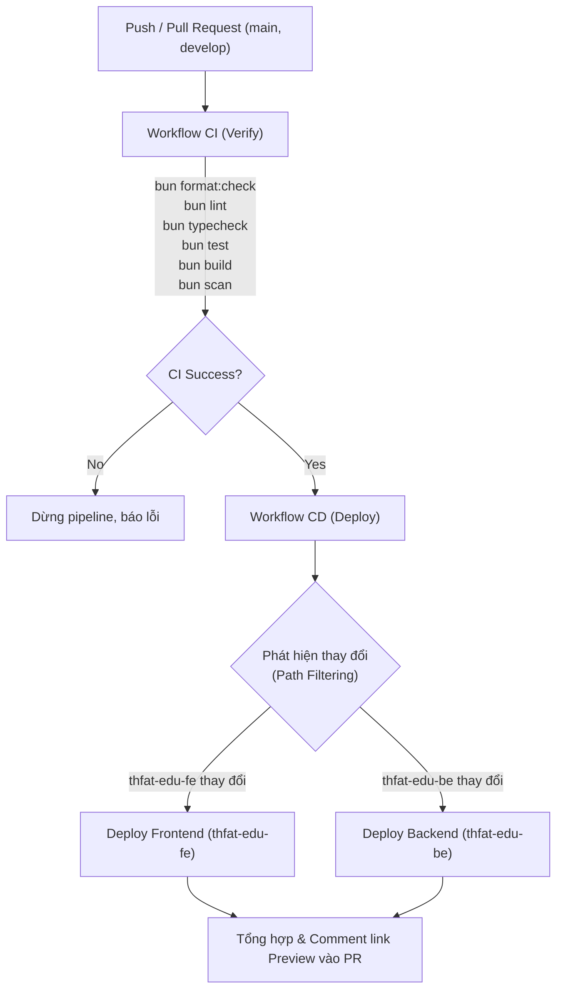

# Hướng dẫn Thiết lập & Triển khai CI/CD (Deployment Guide)

Tài liệu này hướng dẫn chi tiết quy trình thiết lập Continuous Deployment (CD) cho repository **`thfat-edu`** lên nền tảng **Vercel** thông qua **GitHub Actions**.

---

## 1. Kiến trúc Tổng quan

Monorepo bao gồm 2 dịch vụ độc lập được deploy thành 2 project riêng biệt trên Vercel:

| Dịch vụ      | Thư mục        | Framework / Runtime                | Vai trò                             |
| :----------- | :------------- | :--------------------------------- | :---------------------------------- |
| **Frontend** | `thfat-edu-fe` | Next.js 16 (React 19)              | Giao diện người dùng web            |
| **Backend**  | `thfat-edu-be` | ElysiaJS (Bun Serverless Function) | API Backend & Eden Treaty endpoints |

### Luồng CI/CD Pipeline

---

## 2. Bước 1: Tạo Projects trên Vercel Dashboard

Đăng nhập vào [Vercel Dashboard](https://vercel.com/dashboard) và tạo 2 projects:

### A. Tạo Project Frontend (`thfat-edu-fe`)

1. Nhấn **Add New...** $\rightarrow$ **Project**.
2. Chọn repository `thfat-edu`.
3. Cấu hình project:
   - **Project Name:** `thfat-edu-fe` (hoặc tên tuỳ chọn).
   - **Framework Preset:** `Next.js`.
   - **Root Directory:** Nhấn **Edit** và chọn thư mục `thfat-edu-fe`.
4. Trong phần **Environment Variables**, thêm biến:
   - `NEXT_PUBLIC_API_URL`: Điền URL của Backend Vercel (ví dụ: `https://thfat-edu-be.vercel.app` hoặc domain tùy chỉnh).
5. Nhấn **Deploy** (hoặc Save).

### B. Tạo Project Backend (`thfat-edu-be`)

1. Nhấn **Add New...** $\rightarrow$ **Project**.
2. Chọn lại repository `thfat-edu`.
3. Cấu hình project:
   - **Project Name:** `thfat-edu-be` (hoặc tên tuỳ chọn).
   - **Framework Preset:** `Other`.
   - **Root Directory:** Nhấn **Edit** và chọn thư mục `thfat-edu-be`.
4. Không cần cấu hình Build Command đặc biệt vì file `thfat-edu-be/vercel.json` đã chỉ định runtime `bun`.
5. Nhấn **Deploy** (hoặc Save).

---

## 3. Bước 2: Lấy thông tin Credentials từ Vercel

Để GitHub Actions có thể deploy qua Vercel CLI, bạn cần thu thập 4 thông số:

### 1. `VERCEL_TOKEN` (Personal Access Token)

1. Truy cập [Vercel Tokens Settings](https://vercel.com/account/tokens).
2. Nhấn **Create Token**.
3. Đặt tên (ví dụ: `github-actions-thfat-edu`) và chọn thời hạn phù hợp.
4. Sao chép mã token hiển thị.

### 2. `VERCEL_ORG_ID` (Team hoặc User Account ID)

- Nếu dùng tài khoản cá nhân: Truy cập [Vercel Account Settings](https://vercel.com/account), cuộn xuống mục **Your ID** và sao chép mã (bắt đầu bằng `team_...` hoặc `user_...`).
- _Mẹo:_ Nếu bạn đã cài đặt Vercel CLI ở máy local, bạn có thể chạy lệnh `vercel link` ở thư mục dự án, thông tin `orgId` sẽ hiển thị trong `.vercel/project.json`.

### 3. `VERCEL_PROJECT_ID_FE` (Frontend Project ID)

1. Vào project `thfat-edu-fe` trên Vercel Dashboard.
2. Chọn tab **Settings** $\rightarrow$ **General**.
3. Cuộn xuống phần **Project ID** và sao chép mã (dạng `prj_...`).

### 4. `VERCEL_PROJECT_ID_BE` (Backend Project ID)

1. Vào project `thfat-edu-be` trên Vercel Dashboard.
2. Chọn tab **Settings** $\rightarrow$ **General**.
3. Cuộn xuống phần **Project ID** và sao chép mã (dạng `prj_...`).

---

## 4. Bước 3: Cấu hình GitHub Repository Secrets

1. Mở repository `thfat-edu` trên GitHub.
2. Vào **Settings** $\rightarrow$ **Secrets and variables** $\rightarrow$ **Actions**.
3. Nhấn **New repository secret** để thêm 4 secret sau:

| Tên Secret             | Giá trị                                   |
| :--------------------- | :---------------------------------------- |
| `VERCEL_TOKEN`         | Mã token tạo ở Bước 2.1                   |
| `VERCEL_ORG_ID`        | Mã ID tổ chức / người dùng lấy ở Bước 2.2 |
| `VERCEL_PROJECT_ID_FE` | Mã Project ID của Frontend lấy ở Bước 2.3 |
| `VERCEL_PROJECT_ID_BE` | Mã Project ID của Backend lấy ở Bước 2.4  |

> [!IMPORTANT]
> Hãy đảm bảo tên secret khớp chính xác 100% với bảng trên để workflow `.github/workflows/cd.yml` đọc được giá trị.

---

## 5. Quy tắc kích hoạt Deployment

- **Nhánh `main`:** Tự động kích hoạt deploy bản **Production** (`--prod`) sau khi CI verify vượt qua.
- **Nhánh `develop`:** Tự động kích hoạt deploy bản **Staging / Preview** sau khi CI verify vượt qua.
- **Pull Request:** Tự động build và deploy **Preview URL** độc lập cho mỗi PR, sau đó GitHub bot sẽ tự động comment đường dẫn Preview trực tiếp vào bài PR để team test và review.
- **Trigger thủ công (Manual):** Bạn có thể vào tab **Actions** $\rightarrow$ chọn workflow **CD** $\rightarrow$ bấm **Run workflow** để kích hoạt deploy thủ công bất cứ lúc nào.

---

## 6. Kiểm tra & Giám sát

- **GitHub Step Summary:** Mỗi lần CD chạy xong, tab Summary của GitHub Actions sẽ hiển thị bảng trạng thái chi tiết kèm đường dẫn deploy của Frontend và Backend.
- **Vercel Deployments:** Bạn luôn có thể theo dõi logs thời gian thực, quản lý domain và rollback phiên bản trên [Vercel Dashboard](https://vercel.com/dashboard).
