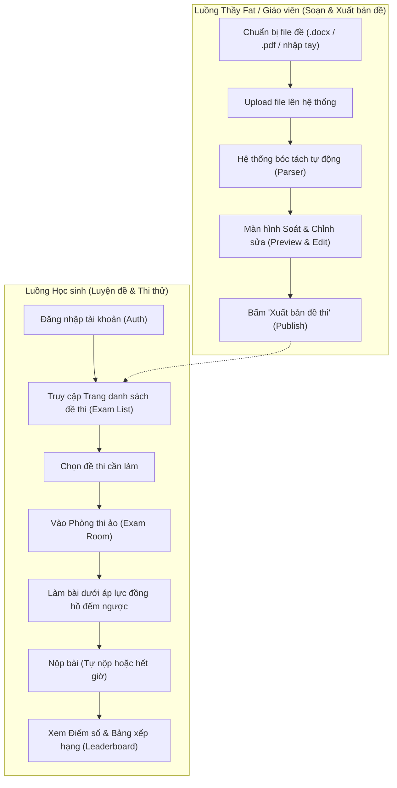
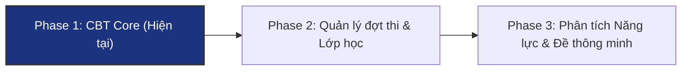

# ThFat Edu — Product Requirements Document (PRD)

> **Tài liệu Định nghĩa & Yêu cầu Sản phẩm (Single Source of Truth)**  
> **Phiên bản:** 1.0.0  
> **Trạng thái:** Active  
> **Ngày phê duyệt:** 04/11/2026  
> **Chủ quản:** Thầy Fat & Đội ngũ Kỹ thuật ThFat Edu

---

## 1. Tầm nhìn & Tuyên ngôn Sản phẩm (Product Vision & Philosophy)

### 1.1. Bối cảnh ra đời

ThFat Edu ra đời từ trăn trở thực tế của **Thầy Fat** trong quá trình đồng hành cùng học sinh: đa số học sinh lớp 12 và thí sinh tự do khi ôn thi môn Hóa học đều gặp tình trạng học tràn lan, mất phương hướng giữa hàng trăm dạng bài tập, hoặc học vẹt công thức mà không hiểu bản chất hiện tượng hóa học.

### 1.2. Sứ mệnh

ThFat Edu được xây dựng nhằm giúp học sinh lớp 12 và thí sinh tự do ôn luyện môn **Hóa học** một cách bài bản:

- **Học đúng trọng tâm**: Tinh giản lý thuyết thừa, tập trung vào các chuyên đề cốt lõi của kỳ thi tốt nghiệp THPT và kỳ thi đánh giá năng lực.
- **Luyện đúng dạng đề**: Cọ xát với các dạng câu hỏi được thầy Fat chọn lọc, sát với cấu trúc đề thi thực tế.
- **Kèm sát tới khi hiểu rõ bản chất**: Học sinh được định hướng phương pháp tư duy bản chất phản ứng thay vì ghi nhớ máy móc.

### 1.3. Mô hình đào tạo & Vai trò của Nền tảng Web

ThFat Edu vận hành theo mô hình kết hợp (**Hybrid Learning**):

- **Học tập & Giảng dạy**: Học sinh có thể tham gia học trực tiếp (offline) tại lớp hoặc học trực tuyến (online) qua các lớp học của Thầy Fat.
- **Nền tảng Web ThFat Edu**: Đóng vai trò là **Cổng thi thử & kiểm tra trực tuyến chuyên sâu (Computer-Based Testing - CBT Portal)**. Nền tảng tập trung tối đa vào trải nghiệm thi thử trên máy chuẩn như thi thật, kiểm tra đánh giá khách quan, loại bỏ các tính năng phân tán như streaming video hay mạng xã hội.

---

## 2. Đối tượng Người dùng (Target Personas)

Hệ thống phục vụ 2 nhóm đối tượng người dùng chính với phân quyền rõ ràng:

### 2.1. Học sinh (Student — Primary Persona)

- **Chân dung**: Học sinh lớp 12 THPT và thí sinh tự do (ôn thi lại) chuẩn bị bước vào kỳ thi Tốt nghiệp THPT, kỳ thi Đánh giá năng lực (ĐGNL) / Đánh giá tư duy.
- **Mục tiêu**:
  - Trải nghiệm thi thử môn Hóa trên máy tính với áp lực thời gian thực tế chuẩn như phòng thi thật.
  - Tự đánh giá năng lực và phản xạ làm bài trắc nghiệm Hóa học.
  - Xem điểm số chính xác và biết được vị trí của mình trên Bảng xếp hạng (Leaderboard) của lớp.
- **Hành vi trên hệ thống**: Đăng nhập tài khoản, truy cập Trang danh sách đề thi, vào phòng thi làm bài, nộp bài và nhận điểm số.

### 2.2. Giáo viên / Quản trị viên (Teacher / Admin — Thầy Fat & Đội ngũ)

- **Chân dung**: Thầy Fat và các trợ giảng trực tiếp quản lý nội dung và đợt thi.
- **Mục tiêu**:
  - Nạp các bộ đề thi môn Hóa có sẵn nhanh chóng mà không tốn công gõ lại từng câu.
  - Kiểm duyệt, chỉnh sửa công thức Hóa học, hình ảnh minh họa thí nghiệm trước khi công bố.
  - Xuất bản đề thi cho học sinh làm và theo dõi thống kê điểm số, bảng xếp hạng toàn lớp.
- **Hành vi trên hệ thống**: Upload file đề (Word/PDF) hoặc tạo đề thủ công, kiểm tra bản xem trước (Preview & Edit), xuất bản đề thi, xem kết quả tổng hợp của học sinh.

---

## 3. Hành trình Người dùng Cốt lõi (Core User Journeys)

### 3.1. Luồng Soạn & Xuất bản Đề thi (Teacher Journey)

1. **Khởi tạo đề thi**: Thầy Fat chọn tải lên file Word (`.docx`), file `.pdf`, hoặc nhập liệu thủ công từng câu hỏi.
2. **Xử lý bóc tách (Parser)**: Hệ thống tự động nhận diện danh sách câu hỏi, các lựa chọn đáp án (A, B, C, D), và trích xuất hình ảnh (sơ đồ thí nghiệm, đồ thị hóa học).
3. **Màn hình Soát & Sửa (Preview & Edit)**:
   - Giáo viên rà soát lại hiển thị công thức hóa học ($\text{H}_2\text{SO}_4$, $\text{Fe}^{3+}$, $\text{CH}_3\text{COOC}_2\text{H}_5$).
   - Đặt đáp án đúng cho từng câu hỏi.
   - Bổ sung hoặc thay thế hình ảnh nếu cần.
4. **Xuất bản đề thi**: Thiết lập tiêu đề đề thi, thời gian làm bài (ví dụ: 50 phút), tổng số điểm, và chuyển trạng thái sang `Published`.

### 3.2. Luồng Thi thử & Đánh giá (Student Journey)

1. **Đăng nhập**: Học sinh đăng nhập qua trang Auth (`/login`).
2. **Trang danh sách đề thi**: Học sinh thấy danh sách các đề thi được Thầy Fat công bố. Mỗi đề hiển thị rõ:
   - Tên đề thi.
   - Thời gian làm bài (phút) và số lượng câu hỏi.
   - Trạng thái của học sinh: _Chưa làm_ hoặc _Đã nộp bài_.
3. **Phòng thi ảo (Exam Room)**:
   - Học sinh bấm "Bắt đầu làm bài". Đồng hồ đếm ngược bắt đầu chạy.
   - Giao diện làm bài tập trung: danh sách câu hỏi, bảng điều hướng câu hỏi (1 đến 40), đánh dấu câu đã chọn và câu cần xem lại.
   - Không chứa các công cụ tra cứu phân tâm (học sinh sử dụng tài liệu giấy bên ngoài như phòng thi thực tế).
4. **Nộp bài**:
   - Học sinh chủ động bấm "Nộp bài" hoặc hệ thống tự động thu bài khi hết thời gian đếm ngược.
5. **Hiển thị kết quả**:
   - **Chỉ hiển thị Điểm số** (và số câu đúng/sai/tổng điểm) ngay sau khi nộp.
   - **Không hiển thị đáp án chi tiết** cho học sinh nhằm bảo mật đề thi và đảm bảo tính kỷ luật trong các đợt thi chung.
   - Hiển thị vị trí trên **Bảng xếp hạng (Leaderboard)** của đề thi.

---

## 4. Quy tắc Nghiệp vụ Cốt lõi (Business Rules)

| STT       | Quy tắc nghiệp vụ                                            | Mô tả chi tiết                                                                                                                                                                                                                                                      |
| :-------- | :----------------------------------------------------------- | :------------------------------------------------------------------------------------------------------------------------------------------------------------------------------------------------------------------------------------------------------------------ |
| **BR-01** | **Chỉ thi một lần duy nhất (Single-Attempt Policy)**         | Mỗi học sinh chỉ được phép làm bài thi thử đúng 1 lần cho mỗi đề thi. Sau khi bài thi đã được nộp (hoặc hết giờ), trạng thái chuyển sang `Submitted` và học sinh không thể thi lại đề này.                                                                          |
| **BR-02** | **Bảo mật đáp án & Lời giải sau thi**                        | Sau khi nộp bài, màn hình kết quả của học sinh **chỉ hiển thị điểm số đạt được**, số câu làm đúng và thời gian hoàn thành. Hệ thống **không mở đáp án chi tiết hay lời giải** cho học sinh ở màn hình kết thúc thi để tránh lộ đề thi giữa các học sinh.            |
| **BR-03** | **Đồng hồ đếm ngược phía máy chủ (Server-timed Submission)** | Thời gian làm bài được tính toán và xác thực tại backend. Ngay khi hết thời lượng quy định, lượt thi tự động đóng và chấm điểm dựa trên các câu trả lời đã lưu.                                                                                                     |
| **BR-04** | **Bảng xếp hạng theo đề thi (Per-Exam Leaderboard)**         | Mỗi đề thi có một bảng xếp hạng ghi nhận danh sách học sinh đã hoàn thành, sắp xếp ưu tiên theo: (1) Điểm số từ cao xuống thấp, và (2) Thời gian hoàn thành nhanh hơn khi bằng điểm.                                                                                |
| **BR-05** | **Phân quyền truy cập tài nguyên (RBAC)**                    | - **Student**: Chỉ đọc danh sách đề thi `Published`, thực hiện 1 lần nộp bài (`QuizSubmission`), xem điểm và leaderboard của đề đó. - **Teacher / Admin**: Toàn quyền CRUD đề thi, quản lý file tải lên, xem toàn bộ chi tiết bài làm và bảng điểm của học sinh. |

---

## 5. Yêu cầu Kỹ thuật & Đặc thù Bộ môn Hóa (Technical & Domain Requirements)

### 5.1. Hiển thị Công thức Hóa học (KaTeX & mhchem)

- Đề thi và câu trả lời phải hỗ trợ chuẩn cú pháp LaTeX với gói mở rộng `mhchem` để hiển thị hoàn hảo:
  - Công thức phân tử và ion: $\ce{Fe3+}$, $\ce{Al2(SO4)3}$, $\ce{[Ag(NH3)2]+}$.
  - Phương trình phản ứng và điều kiện: $\ce{CH4 + Cl2 ->[as] CH3Cl + HCl}$.
  - Chỉ số trên, chỉ số dưới, trạng thái chất ($\downarrow$, $\uparrow$).
- Frontend render bằng thư viện KaTeX tối ưu hiệu năng, không gây giật lag khi cuộn qua danh sách 40 câu hỏi.

### 5.2. Hỗ trợ Hình ảnh Thí nghiệm & Đồ thị

- Khả năng đính kèm hình ảnh mô tả thí nghiệm (bình kíp, điện phân, ống nghiệm) và đồ thị chuẩn độ/kết tủa trong nội dung câu hỏi.
- Hình ảnh được lưu trữ an toàn, hỗ trợ nén và hiển thị responsive rõ nét trên cả màn hình máy tính và máy tính bảng.

### 5.3. Kiến trúc Dữ liệu Đề thi (Drizzle ORM & Postgres)

Khung thực thể đề thi theo kiến trúc backend đã thống nhất (`docs/adr/0003-backend-architecture-and-data-layer.md`):

- `quizzes`: Thông tin đề thi (tiêu đề, thời lượng làm bài tính bằng phút, trạng thái nháp/xuất bản, người tạo).
- `quiz_questions`: Câu hỏi, nội dung Markdown/KaTeX, thứ tự, điểm số, hình ảnh đính kèm, đáp án đúng (chỉ lộ cho giáo viên).
- `quiz_options`: Các phương án lựa chọn (A, B, C, D) cho từng câu hỏi.
- `quiz_submissions`: Lượt làm bài của học sinh (gắn với `user_id`, thời điểm bắt đầu, thời điểm nộp bài, tổng điểm, câu trả lời đã chọn).

### 5.4. Giao diện & Trải nghiệm Người dùng (Design System)

- Tuân thủ nghiêm ngặt bộ màu thương hiệu ThFat Edu (`GLOSSARY.md`):
  - Primary Scale Navy Blue `#1C3480` (`--primary-700`).
  - Giao diện phòng thi tập trung (Distraction-free Exam Layout).
  - Tương thích tốt trên thiết bị học tập của học sinh (Desktop & Laptop).

---

## 6. Lộ trình Phát triển Sản phẩm (Product Roadmap)

### Phase 1: MVP Core (Giai đoạn hiện tại)

- [x] Kiến trúc xác thực tài khoản (Auth) & Design System tokens.
- [ ] Tính năng Import đề thi từ file Word (.docx) / PDF và giao diện Soát đề (Preview & Edit) cho Thầy Fat.
- [ ] Trang danh sách đề thi (Exam List) cho học sinh.
- [ ] Màn hình Phòng thi ảo (Exam Room) chuẩn hóa với đồng hồ đếm ngược và quy tắc thi 1 lần duy nhất.
- [ ] Chấm điểm tự động và Bảng xếp hạng (Leaderboard) theo đề thi (chỉ hiện điểm số sau nộp bài).

### Phase 2: Quản lý Đợt thi & Lớp học Hybrid (Trung hạn)

- Quản lý đợt thi theo lịch: Đóng/mở đề theo khung giờ học thực tế của lớp Thầy Fat.
- Xuất báo cáo bảng điểm ra file Excel cho Thầy Fat và trợ giảng theo dõi chuyên cần.
- Tùy chọn mở chế độ "Xem lại đề & Lời giải chi tiết" sau khi kết thúc toàn bộ đợt thi chung.

### Phase 3: Cá nhân hóa & Phân tích Năng lực (Dài hạn)

- Phân tích thống kê lỗ hổng kiến thức môn Hóa (học sinh thường sai ở chuyên đề vô cơ hay hữu cơ, lý thuyết hay bài tập tính toán).
- Hệ thống giải đáp thắc mắc theo ngữ cảnh bài học/câu hỏi thi.
- Ngân hàng câu hỏi nâng cao tự động sinh đề phân hóa 8-9-10 điểm.
